# Supply Chain Inventory Optimization & Supplier Risk Analytics

### [Open the live interactive dashboard](https://d2497.github.io/supply-chain-inventory-risk-analytics/)  ·  no install needed

[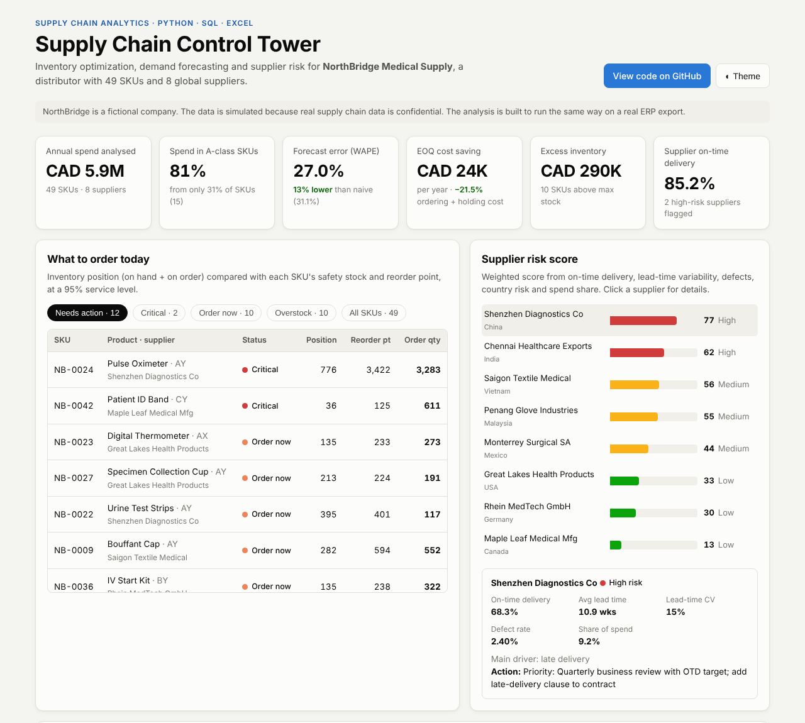](https://d2497.github.io/supply-chain-inventory-risk-analytics/)

[](https://www.linkedin.com/in/dhruvilupadhyay24)

**Tools:** Python (pandas) · SQL · Excel (formula-driven model) · Power BI (DAX, data model) · HTML dashboard

An end-to-end supply chain analytics project built three ways: an automated **Python + SQL** pipeline, a live **Excel** model, and a **Power BI** report. It answers six questions a supply chain team faces every week:

1. **What should we order today, and how much?** (safety stock, reorder point, EOQ)
2. **Which products deserve the most attention?** (ABC-XYZ segmentation)
3. **How much demand should we plan for?** (forecasting, with a fair test of five methods)
4. **Which suppliers put us at risk?** (supplier scorecard and a 0–100 risk score)
5. **What happens if a supplier is delayed?** (disruption what-if simulator)
6. **Should we buy offshore or nearshore?** (total landed cost: price, freight, duty, brokerage and inventory carrying cost)

> **About the data:** the project runs in two modes.
> - **Real data (recommended):** product, price and ~180K order lines of demand from the Kaggle dataset [DataCo Smart Supply Chain](https://www.kaggle.com/datasets/shashwatwork/dataco-smart-supply-chain-for-big-data-analysis). Supplier purchase orders and stock levels are simulated, because no public dataset includes inbound supplier data. See [Using the Kaggle data](#using-the-kaggle-data).
> - **Simulated (default if the Kaggle file is missing):** *NorthBridge Medical Supply*, a **fictional** Ontario distributor. `src/generate_data.py` simulates two years of realistic data (Pareto-shaped spend, flu-season PPE spikes, suppliers whose reliability depends on distance). The analysis code doesn't see the hidden simulation settings and has to discover supplier behaviour from the purchase-order history.
>
> The results below are from the simulated mode. Re-run with the Kaggle file to get real-data results.

---

## Key results

| Area | Result |
|---|---|
| Spend concentration | **15 of 49 SKUs (31%) = 81% of CAD 5.9M annual spend** (A-class) |
| Forecasting | Selected models reached **27.0% WAPE vs 31.1% for a naive forecast** (13% lower error) on an unseen 12-week test window |
| Ordering cost | Switching from "order 4 weeks of stock" to **EOQ cuts ordering + holding cost by 21.5% (~CAD 23.9K/yr)** |
| Stock health | **12 SKUs need an order now (2 critical)**, **10 SKUs overstocked**, tying up **CAD 290K** of excess inventory |
| Suppliers | Overall on-time delivery is **85.2%**. **2 suppliers are high-risk**, and 2 reliable suppliers hold **69% of spend** (concentration risk) |
| Disruption | A 4-week delay at the highest-risk supplier would stock out **3 of its 4 SKUs**, putting **CAD 102K of revenue at risk**. A CAD 47K buffer would prevent it |
| Landed cost | Of **26 offshore SKUs**, **7 are cheaper from Mexico** (CAD 139K/yr), and **16** are worth nearshoring for a premium under 3%, freeing **CAD 287K** of inventory and cutting lead time by **4.2 weeks** |

Full details: [`reports/key_findings.md`](reports/key_findings.md). The Excel report with 9 tabs is in [`reports/supply_chain_report.xlsx`](reports/supply_chain_report.xlsx).

---

## Business recommendations

1. **Expedite 2 critical SKUs and place 12 reorders today.** Start with Pulse Oximeter, which sits below safety stock with a 10.9-week lead time.
2. **Run a quarterly business review with the 2 high-risk suppliers** (China and India). Late delivery is the main driver for both, with on-time rates of 68–72%.
3. **Move the 7 German-sourced SKUs to a Mexican supplier.** It's cheaper in total landed cost (about CAD 139K/yr) and lead time drops from 5.8 to 4.0 weeks.
4. **Qualify a nearshore second source for China and India SKUs.** It costs about 2% more but halves lead time and frees inventory, the same SKUs the disruption simulator shows are most at risk.
5. **Switch to EOQ ordering (about CAD 24K/yr saving) and work down the CAD 290K of excess stock** on 10 overstocked SKUs.

## Charts

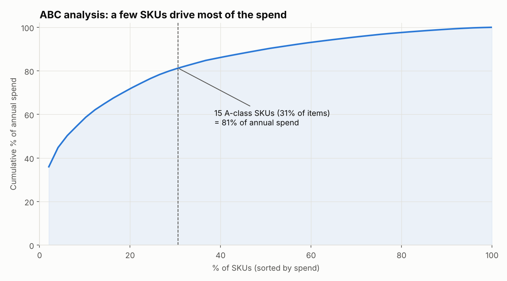

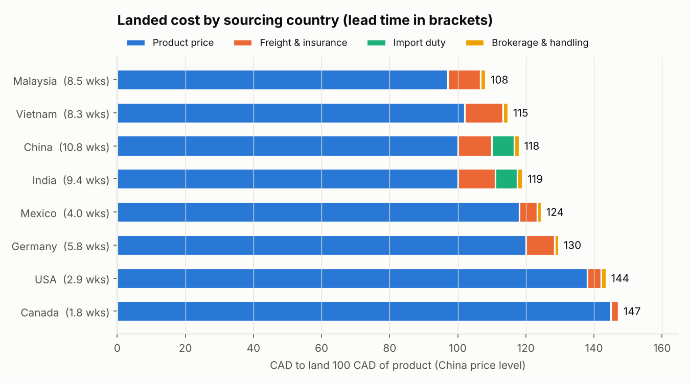

| | |
|---|---|
| 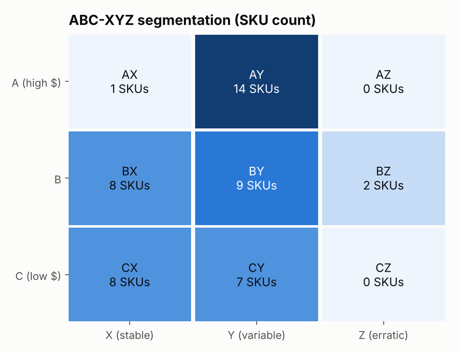 | 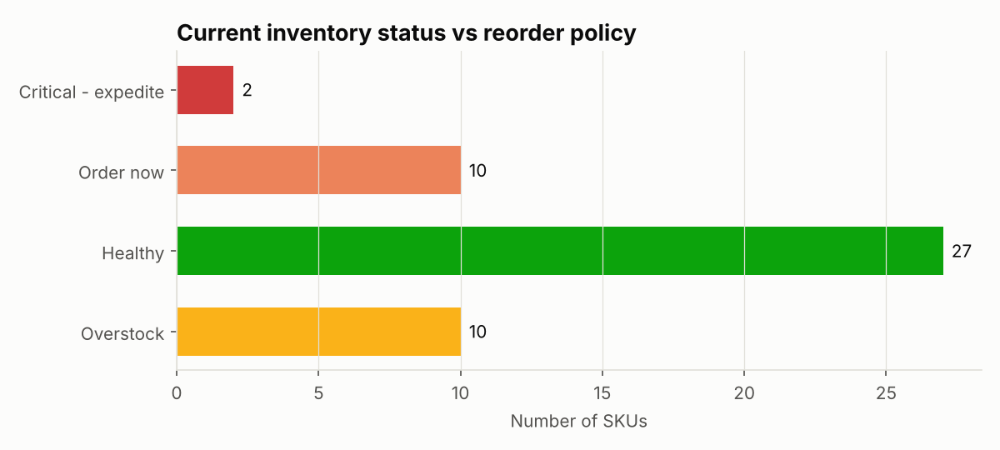 |
| 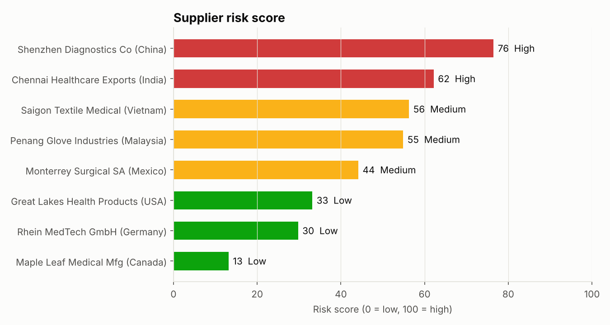 | 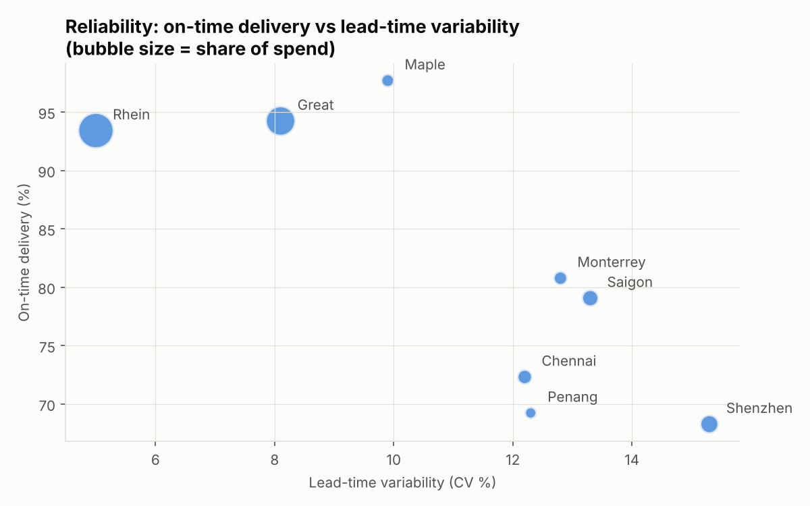 |

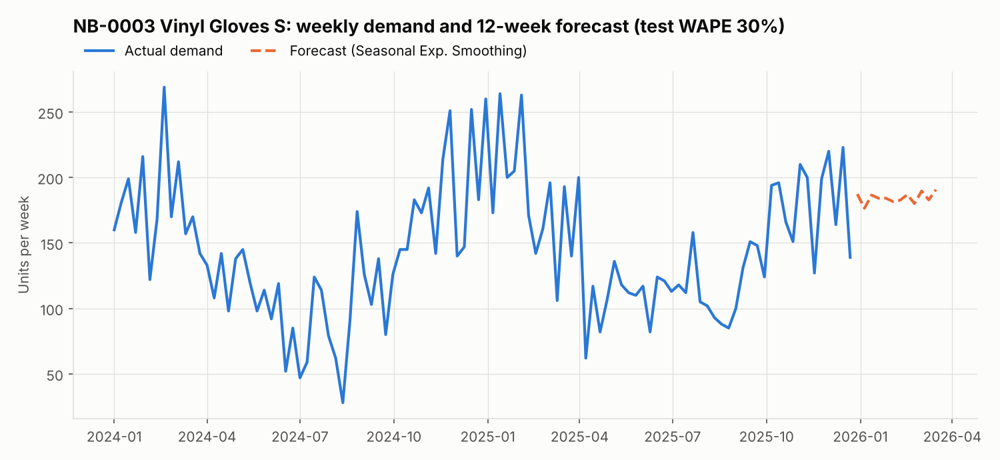

---

## How it works

```
generate_data.py ──► 5 CSV files ──► SQLite database ──► SQL queries
                                                           │
           ┌───────────────────────┬───────────────────────┼──────────────────────┐
           ▼                       ▼                       ▼                      ▼
   forecasting.py           inventory.py           supplier_risk.py         scenario.py
   5 methods per SKU,       ABC-XYZ, safety        scorecard + 0-100        "what if supplier X
   validation + test        stock, ROP, EOQ,       risk score + action      is delayed N weeks?"
                            reorder alerts
           └───────────────────────┴──────────┬────────────┴──────────────────────┘
                                              ▼
      Interactive dashboard (docs/index.html) · Excel report (9 tabs) · 6 charts · key_findings.md
```

### 1. SQL analysis (`sql/analysis_queries.sql`)
The CSVs are loaded into SQLite. SQL calculates supplier **on-time delivery (OTD)**, **actual lead time**, **fill rate**, **defect rate**, **spend share by supplier** and **spend by category**.

### 2. Demand forecasting (`src/forecasting.py`)
Five methods compete for each SKU: naive, 4-week moving average, exponential smoothing, seasonal naive, and seasonal exponential smoothing (which removes the yearly pattern, smooths what's left, then adds the pattern back).

To keep the accuracy numbers honest, the **winner is picked on a validation window** (weeks −24 to −13) and **graded on a separate test window** (last 12 weeks). Accuracy is measured with **WAPE**, because MAPE breaks when a week has zero sales.

> **What I learned:** plain exponential smoothing applied to every SKU scored about the same as per-SKU selection (26.5% vs 27.0% WAPE). With only two years of noisy history, a simple, robust method is hard to beat. Model selection mainly helps the strongly seasonal PPE items.

### 3. Inventory policy (`src/inventory.py`)

| Metric | Formula |
|---|---|
| Safety stock | `SS = z × √(LT × σd² + d² × σLT²)`, which covers demand **and** lead-time uncertainty |
| Reorder point | `ROP = d × LT + SS` |
| Economic order quantity | `EOQ = √(2DS / H)` |
| Status | Critical (below SS) · Order now (≤ ROP) · Healthy · Overstock (> ROP + EOQ) |

`z` = 1.645 for a 95% service level. `σd` is the **forecast error** (not raw demand variation), and `LT` and `σLT` are the **measured** supplier lead times. Each ABC-XYZ segment gets a stocking strategy (e.g. AZ → dual-source and buffer, CX → fully automate).

### 4. Supplier risk score (`src/supplier_risk.py`)

| Factor | Weight |
|---|---|
| Late delivery (1 − OTD) | 30% |
| Lead-time variability (CV) | 20% |
| Quality (defect rate) | 20% |
| Country/route risk | 15% |
| Spend dependency | 15% |

Each factor is scaled against a "clearly bad" threshold, so a score means the same thing as suppliers are added or removed. The model reports the **main driver** for each supplier and a matching **recommended action** (e.g. a SCAR for quality problems, nearshoring for country risk, dual sourcing for concentration).

### 5. Interactive dashboard (`src/dashboard.py` → `docs/index.html`)
A single self-contained HTML file, published free with GitHub Pages. It has a reorder list you can filter, a supplier risk drill-down, a forecast explorer for every SKU, an ABC-XYZ matrix, and a **live disruption simulator** (pick a supplier, drag the delay slider). It runs the same formulas as the Python code in the browser.

### 6. Disruption simulator (`src/scenario.py`)
```bash
python src/scenario.py --supplier S08 --delay 4
```
For each SKU from that supplier it shows weeks until stockout, units short, revenue at risk, and the extra buffer stock needed.

---

### 7. Logistics & landed cost (`src/landed_cost.py`)
Compares every offshore SKU with the best nearshore option (Mexico, USA or Canada) on **total annual landed cost**:

```
landed unit cost = price x (1 + freight% + duty% + brokerage%)
total per year   = units x landed unit cost + (safety stock + in-transit inventory) x landed unit cost x 22%
```

A long lead time costs money twice: more safety stock, and more stock sitting on the ocean (FOB origin terms, so we own it from the port of loading). Lead times and their variability come from the purchase-order history. Prices, freight and duty are **illustrative assumptions** in `src/config.py`, with duty-free treatment under CUSMA (USA, Mexico), CETA (Germany) and CPTPP (Vietnam, Malaysia).

Recommendations: **Nearshore** if total cost is lower, **Nearshore candidate** if the premium is under 3% (resilience is worth paying a little for), otherwise **Keep offshore**. Result: Asian sources still win on price for low-cost items like gloves and wipes, while Germany-to-Mexico moves pay for themselves.

## Excel model (`excel/Supply_Chain_Analytics.xlsx`)
A working Excel model where **every result is a formula** (about 18,000 of them), so a planner can change an assumption and see everything update:

| Sheet | What it does |
|---|---|
| Dashboard | KPI tiles, inventory status chart, supplier risk chart, ABC-XYZ matrix, "what to order today" list |
| Assumptions | Service level, ordering and holding cost, ABC/XYZ cut-offs, risk weights. Blue-on-yellow cells are inputs |
| Inventory_Policy | One row per SKU: `SUMIFS`/`AVERAGEIFS` demand statistics, ABC-XYZ, safety stock (`NORMSINV`), reorder point, EOQ, status |
| Supplier_Scorecard | On-time delivery, lead time and variability, fill rate, defect rate, weighted risk score and recommended action |
| Forecast | Dropdown SKU picker, back-test of moving average, exponential smoothing and seasonal naive (WAPE), 12-week forecast chart |
| Disruption_Simulator | Pick a supplier and a delay to see the SKUs that stock out and the revenue at risk |
| Landed_Cost | Country cost assumptions (inputs) and an offshore vs nearshore comparison for every overseas SKU |

Techniques: named ranges, `INDEX`/`MATCH`, `SUMIFS`, `COUNTIFS`, `SUMPRODUCT`, data validation dropdowns, conditional formatting, and dynamic lists without VBA. The workbook is rebuilt by `src/build_excel.py`.

## Power BI report (`powerbi/`)
A 6-page **Power BI** report (Overview, Inventory Policy, Supplier Scorecard, Demand & Forecast, Disruption Simulator, Landed Cost & Nearshoring) on a **star-schema** data model, with **50+ DAX measures** and **what-if parameters** for service level and supplier delay. It's saved as a Power BI Project (`.pbip`), so the model (TMDL) and report (PBIR) are readable text in this repo. Open `powerbi/SupplyChainControlTower.pbix` (or the `.pbip`) in Power BI Desktop. See [`powerbi/README.md`](powerbi/README.md) for details.

| | |
|---|---|
| 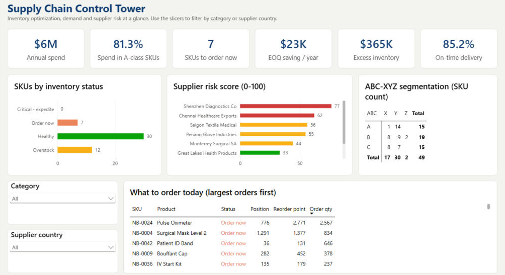 | 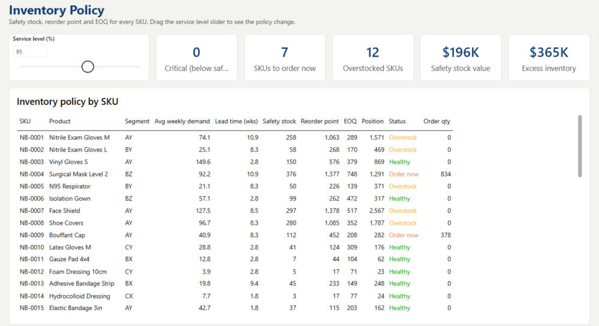 |
| 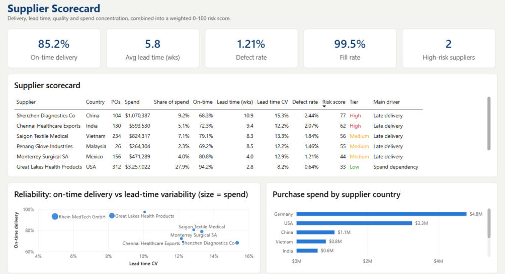 | 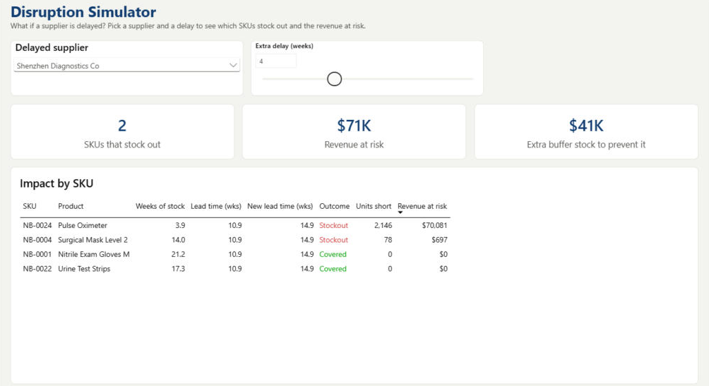 |

| 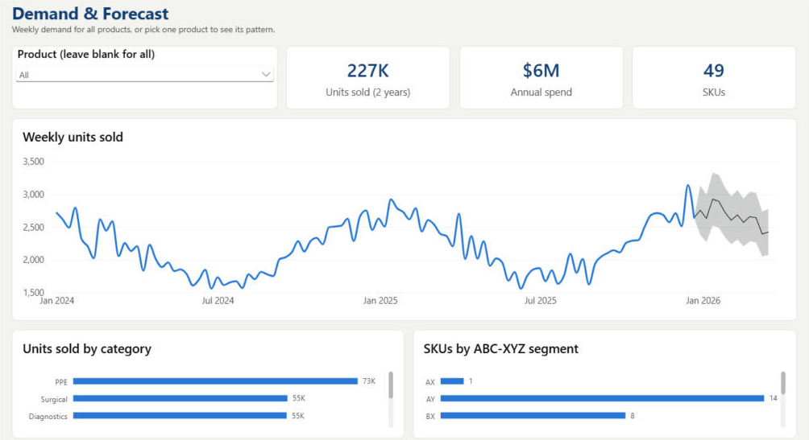 | 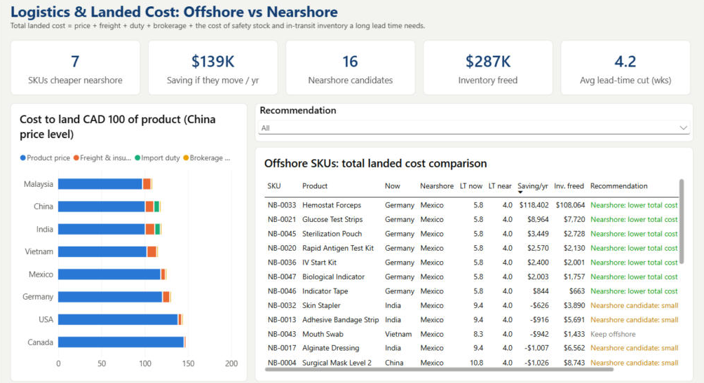 |
|---|---|

## Run it yourself

```bash
git clone https://github.com/D2497/supply-chain-inventory-risk-analytics.git
cd supply-chain-inventory-risk-analytics
pip install -r requirements.txt

python src/main.py                               # full pipeline, about 15 seconds
                                                 # then open docs/index.html and excel/Supply_Chain_Analytics.xlsx
python src/scenario.py --supplier S06 --delay 6  # try your own what-if
pytest                                           # 9 unit tests for the formulas
```

All business assumptions (service level, ordering cost, holding cost rate, risk weights) live in [`src/config.py`](src/config.py). Change one and re-run.

## Using the Kaggle data
1. Download [DataCo Smart Supply Chain for Big Data Analysis](https://www.kaggle.com/datasets/shashwatwork/dataco-smart-supply-chain-for-big-data-analysis) from Kaggle.
2. Copy `DataCoSupplyChainDataset.csv` into `data/raw/`.
3. Run `python src/main.py`. The output says `Loading Kaggle DataCo data`.

`src/load_kaggle_dataco.py` removes cancelled and fraud orders, builds weekly demand per product, picks the last 104 "normal" weeks (the file thins out at the very end), and keeps the top 60 products by spend that sell in at least 80% of weeks. It converts prices from USD to CAD (rate set in `config.py`) and assigns each product to a supplier based on its department. Everything after that (SQL, forecasting, inventory policy, risk, dashboard) runs unchanged.

## Project structure
```
├── docs/                  # interactive dashboard (GitHub Pages)
├── excel/                 # live Excel model (formulas, dashboard, simulator)
├── powerbi/               # Power BI build guide, DAX measures, Power Query, theme
├── data/raw/              # put the Kaggle CSV here (not uploaded)
├── data/                  # generated CSVs (suppliers, products, demand, POs, stock)
├── sql/analysis_queries.sql
├── src/
│   ├── config.py          # all assumptions in one place
│   ├── generate_data.py   # realistic simulated dataset
│   ├── load_kaggle_dataco.py  # real-data mode: Kaggle DataCo -> same 5 tables
│   ├── database.py        # CSV → SQLite, runs named SQL queries
│   ├── forecasting.py     # 5-method forecast with validation/test split
│   ├── inventory.py       # ABC-XYZ, SS, ROP, EOQ, status
│   ├── supplier_risk.py   # scorecard + risk score + actions
│   ├── scenario.py        # disruption what-if (CLI)
│   ├── landed_cost.py     # offshore vs nearshore total landed cost
│   ├── charts.py          # PNG charts
│   ├── dashboard.py       # builds docs/index.html from the results
│   ├── build_excel.py     # builds the formula-driven Excel model
│   └── main.py            # runs everything, writes the reports
├── reports/               # Excel report, charts, key findings
└── tests/                 # pytest unit tests
```

## Supply chain concepts applied
Inventory management · safety stock and reorder point · Economic Order Quantity (EOQ) · ABC-XYZ analysis · demand forecasting and forecast accuracy · supplier performance management (OTD, fill rate, defect rate) · supplier risk assessment · supply chain risk and resilience · total cost thinking (ordering vs holding cost) · total landed cost (freight, duty, brokerage, inventory carrying) · global sourcing and nearshoring · trade agreements (CUSMA, CETA, CPTPP) · Incoterms (FOB) and in-transit inventory.

These concepts come from my **Master Certificate in Global Supply Chain Management (Michigan State University, Eli Broad College of Business, 2026)**.

## Possible next steps
- Swap the simulated CSVs for a real ERP export (the same column names are all that's needed)
- Multi-echelon inventory (warehouse + clinics) and Monte Carlo lead-time simulation

## Author
**Dhruvilkumar Upadhyay** · [LinkedIn](https://www.linkedin.com/in/dhruvilupadhyay24) · dhruvil.u24@gmail.com

